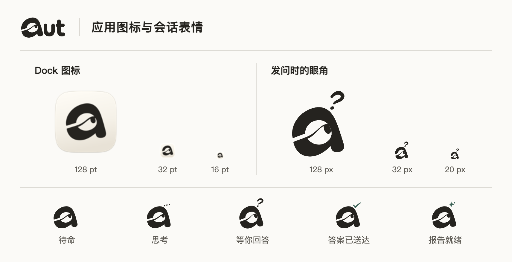

# aut 品牌

## 标志

- 单眼角色承担首字母 `a`，右接圆笔画的 `ut`。侧栏使用完整字标，可访问名称为 `aut`。待命时角色微微侧倾，眼角上方留白。眼睑与瞳孔的来历见[原始草图](assets/brand/logo.png)。
- macOS 应用图标使用暖白方圆底上的待命侧眼，四角留透明余量。16、32 pt 使用放大眼白与瞳孔的小尺寸图形。Finder 的常规和 Retina 尺寸按显示点数选择图形。
- 首次会话和 chief 使用品牌角色。每个 Bot 可在编辑器选择自己的形象，头像紧邻发言人名称。默认主助手使用单眼 a，普通 Bot 使用名称首字。

## 配色

| 用途 | 浅色 | 深色 |
| --- | --- | --- |
| 会话画布 | 暖白 `#FBFAF7` | 暖炭 `#1B1C19` |
| 侧栏、助手气泡 | 灰米 `#F2EFE9`、浅灰米 `#F1EEE8` | 炭灰 `#23241F`、`#2C2D28` |
| 主文字 | 墨黑 `#25231F` | 暖白 `#EFECE4` |
| 用户气泡 | 墨黑 `#25231F` | 深灰绿 `#394C42` |
| 辅助说明、时间 | 灰褐 `#6B665E` | 浅灰褐 `#B7B3A7` |
| 工作中、链接、焦点 | 深青绿 `#35675B` | 浅青绿 `#93CDB7` |

颜色状态同时配文字。桌面正文使用 Geist 和系统中文字体，主会话沿用 15 px 正文与 22 px 行高。

## 桌面样式

桌面随 macOS 实时切换外观。React 入口 `DesktopTheme` 将系统外观传给 Radix Themes，页面、弹层及原生控件共用浅色或深色。颜色、字体、圆角和 Radix 色阶映射集中在主题样式表。[主题入口](../apps/desktop/src/ui/theme.tsx) · [主题变量](../apps/desktop/src/styles/theme.css) · [ADR-0054](decisions/0054-system-appearance-and-component-preview.md)

通用交互优先使用 Radix Themes。业务组件使用小写连字符类名和语义变量维护布局与状态。桌面与组件预览从同一份样式入口加载本地字体、控件和角色样式。改动后可在预览里切换外观，检查弹层、代码和角色在两套配色下的可读性。[样式入口](../apps/desktop/src/style.css) · [组件预览](desktop.md#组件预览) · [ADR-0051](decisions/0051-desktop-component-library.md)

## 单眼 a 的动效

| 出现位置与时机 | 角色表情 |
| --- | --- |
| Dock、侧栏字标、欢迎页、普通头像 | 安静的待命侧眼 |
| 主会话出现工作提示 | 三个墨点从眼角依次浮出，随后停住 |
| 角色发问 | 墨点聚成短问号，底点与眉缘留一道缝。等待作答与原通道确认时保持定格 |
| 当前原生问题首次确认送达 | 角色点头，画一次青绿色对勾，随后收回 |
| 角色的完整报告抵达主会话 | 眼角短暂闪出四角星，同一消息组使用发言人旁的头像 |

笔画附在头部的同一坐标系中，跟着眼睑的方向轻轻回落。翻阅历史时，待答问题显示静态问号，已结束的消息显示待命侧眼。系统开启「减少动态效果」时，各状态直接切换到定格，送达和报告的短时反馈仍按时收回。投递文字和状态读取见[问题卡](desktop.md#问题卡)。

## 资产

[矢量母版](../packages/characters/assets/aut.svg)包含字标、两档角色和眼角笔画。[应用图标](../apps/desktop/assets/aut-icon.png)供开发启动使用，macOS 包使用同目录的 `aut.icns`。修改母版后，在 macOS 执行 `pnpm --filter @aut/desktop icons:mac` 重新生成。设计取舍见 [ADR-0049](decisions/0049-desktop-brand-application.md) 和 [ADR-0052](decisions/0052-eye-corner-expressions.md)。其他形象和动作的扩展见[角色模块](../packages/characters/README.md)。
